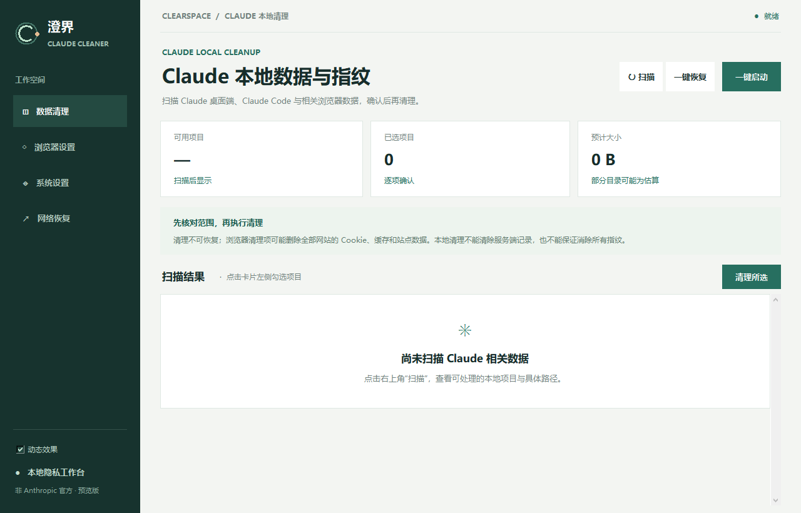

<div align="center">


# 澄界 · Clearspace

**面向 Claude 本地指纹、数据与隐私设置的清理工作台**

扫描可识别的 Claude 桌面端、Claude Code 和浏览器数据，逐项核对范围后再处理。

[English](docs/README.en.md) · [使用边界与恢复](docs/SAFETY.md) · [第三方组件](THIRD_PARTY_NOTICES.md)

**Windows 预览版** · Python + Tkinter 界面 · JavaScript 兼容核心

[](https://github.com/Cheng02lema/clearspace/actions/workflows/tests.yml)

</div>

> **请先阅读：**清理会永久删除数据，不会创建恢复备份。浏览器清理项可能删除 Chrome、Edge 和 Firefox 中**所有网站**的 Cookie、缓存与站点数据，并使网站退出登录。执行前请关闭相关程序，并核对每一个路径。
>
> “一键恢复”只尝试恢复有有效记录的部分 DNS 和浏览器定位、语言设置；**不能恢复被清理的数据，也不能保证还原所有设置**。本项目为独立工具，与 Anthropic 没有关联。

## 界面预览



首次启动时不会自动扫描。主界面集中显示扫描结果、已选项目与一键操作入口；浏览器、系统和网络恢复各有独立页面。

## 澄界能做什么

| 区域 | 功能与实际范围 |
| --- | --- |
| **Claude 本地数据** | 扫描符合结构特征的桌面端和 Claude Code 数据、配置或凭据；实际项目及路径以扫描结果为准。 |
| **浏览器数据** | 可清理受支持浏览器的 Cookie、缓存和网站存储。**此项覆盖所有网站，而非仅限 Claude。**另提供独立的 mail.com Cookie 清理。 |
| **浏览器设置** | 管理定位、语言、WebRTC 及 AdGuard 相关设置；可能影响网站定位、网页通话、浏览器策略与现有扩展。 |
| **系统设置** | 清理当前用户的 Claude 专用环境变量；可选择调整系统定位、DNS、时区及区域。部分操作需要管理员授权。 |
| **一键流程** | 扫描后先展示路径与设置，确认后关闭列出的浏览器并依次执行；有冲突或安全限制的项目会列出并跳过。 |
| **网络恢复** | 检查本工具相关的 DNS 残留及可识别的失效本机代理；恢复依据不足时不会承诺完整还原。 |

本工具处理的是**本机可识别的数据和设置**。它无法删除 Anthropic 服务端记录，不能保证消除所有设备或浏览器指纹，也不保证影响账号限制。官方配置与数据管理方式请参阅 [Claude Code 设置文档](https://code.claude.com/docs/en/settings) 和 [Claude 数据导出说明](https://support.claude.com/en/articles/9450526-export-your-claude-data)。

## 快速开始

**运行环境**

- Windows 10 / 11；当前主要在 Windows 上开发和测试。
- Python **3.10 或更新版本**，安装时需包含 Tkinter。
- Node.js **24.4 或更新版本**，需能通过 `node` 命令访问。部分 Cookie 操作使用 Node 内置 SQLite。
- 无需 Electron 或 `npm install`。需要修改系统策略、DNS 或定位的操作可能触发 Windows 管理员授权。

下载仓库代码并解压，在项目目录双击 **`start.cmd`**。也可以克隆后通过终端运行：

```powershell
git clone https://github.com/Cheng02lema/clearspace.git
cd clearspace
python run.py
```

首次启动不会自动扫描。点击“扫描”查看结果，或点击“一键启动”检查完整执行清单。扫描的文件大小可能是限时估算值；结果受权限、目录结构和扫描预算影响，不能视为完整清单。

## 推荐使用流程

1. 保存工作，备份需要保留的 Claude 会话、配置、MCP 设置及浏览器数据。
2. 点击 **扫描**，阅读每项描述、风险和本机路径；只勾选确实需要清理的内容。
3. 根据提示退出 Claude、相关 IDE 和浏览器；再次核对确认窗口。
4. 单独调整需要的浏览器或系统设置，或在理解影响后使用 **一键启动**。
5. 如需撤销本次一键流程中可恢复的部分设置，打开 **一键恢复**；网络异常时可先查看 **网络恢复** 页面。

> 一键启动中的互斥操作不会同时执行；确认窗口会标明跳过项。若上一次的一键操作仍有可恢复的设置，需先处理恢复记录，才能再次运行一键启动。

## 隐私、联网与恢复边界

- 扫描与清理由本地程序执行；不要将结果截图、日志或清单公开分享，里面可能包含用户名和本地路径。
- 代理地区和时区同步会请求 `ipwho.is` 或 `ipapi.co`；DNS 保护会进行 Cloudflare 连通性检查，并使用 DNSCrypt 配置中的解析服务。AdGuard 设置会打开官方扩展商店和配置页。因此**本工具并非完全离线**。
- 浏览器专用代理或 PAC 的行为可能与本应用读取到的系统代理不同；位置查询失败时应检查网络设置。
- 一键恢复依赖本次操作产生且未变化的恢复记录；没有记录、记录已改变，或修改前已有旧记录时会保守跳过。其他程序之后对设置做出的变更也可能影响恢复结果。
- 清理不会更改平台服务器端数据。若要管理 Claude 账号或导出数据，请使用 Anthropic 官方渠道。

更具体的说明见 [使用边界与恢复](docs/SAFETY.md)。

## 当前状态

这是可运行的迁移预览：**界面和调度使用 Python / Tkinter，但核心清理、浏览器策略和 DNS 逻辑仍依赖原有 JavaScript 兼容层**，并非纯 Python 实现。尚未提供经过完整端到端验证的安装包。建议先在测试账户或虚拟机中评估，再处理重要数据或系统网络设置。

```text
clearspace/             Python 界面、动作分类、一键流程
legacy/bridge.js        本地兼容接口
legacy/src/core/        原有清理、浏览器和系统逻辑
legacy/assets/          图标及 DNSCrypt 资源
tests/                  模拟流程、路径保护和本地界面测试
```

## 开发与验证

```powershell
python -m unittest discover -s tests -v
node --test tests/legacy-cleaner.test.js tests/browser-process.test.js
```

测试使用模拟流程和新建临时文件，不会清理用户数据或修改系统网络设置。DNS、管理员授权和浏览器策略尚未在所有 Windows 配置上做真实端到端验证。

## 常见问题

**为什么一键恢复无法恢复文件？** 当前清理沿用永久删除流程，不创建文件备份；恢复入口只针对符合条件的部分设置。

**为什么登录状态丢失？** 浏览器清理会删除 Cookie 和站点存储，影响的不止 Claude。清理 Claude Code 凭据也可能要求重新登录。

**为什么要关闭浏览器？** 浏览器运行时可能锁定或重新写入数据；关闭操作会结束相关进程，未保存的表单、下载和隐私窗口可能丢失。

**为什么需要 Node.js？** 桌面界面已迁移到 Python，但部分安全核心仍保留为 JavaScript，后续需要逐项迁移和验证。

**为什么某些项目被跳过？** 项目可能互斥、与其他路径重叠、被安全检查阻止，或在确认后发生变化。请以界面中的具体原因和结果为准。

## 许可与第三方组件

项目代码使用 [MIT 许可证](LICENSE)。内置 DNSCrypt-Proxy 按其原 ISC 许可证分发，详情见 [第三方组件](THIRD_PARTY_NOTICES.md)。Claude 和 Anthropic 是其各自权利人的名称；本项目不是官方产品。
